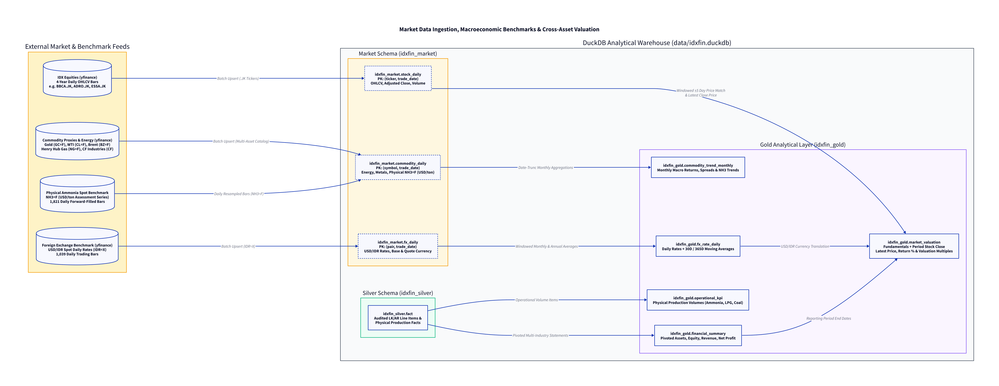

# IDX Financial Statement & Annual Report Extraction Pipeline

-----------

An enterprise-grade, LLM-powered extraction and analysis pipeline for Indonesian capital market filings (**Bursa Efek Indonesia / IDX**). 

The system automates the ingestion, structural sectionizing, information extraction, normalization, accounting validation, and analytical aggregation for:
- **Financial Statements (Laporan Keuangan / LK)**: Both annual audited (`fs_annual`) and interim quarterly (`fs_interim`: Q1, H1, 9M).
- **Annual Reports (Laporan Tahunan / AR)**: Comprehensive 400+ page corporate reports (`annual_report`) covering operational performance reviews, MD&A, management guidance, corporate governance, and ESG metrics.

> **Architecture & Design Documentation**: For the in-depth architectural design log, dataflow diagrams, prompting strategies, token management, and multi-layer validation engine, see [docs/DESIGN_LOG.md](file:///Users/Rayhan.Kharisma/Documents/prsnl-prjct/statements-extraction/docs/DESIGN_LOG.md).

---

## 🏛️ System Architecture

The pipeline implements an end-to-end Medallion Lakehouse architecture—unifying corporate financial statement extraction, macroeconomic commodity benchmarks, daily FX rates, cross-asset valuation, and an autonomous Conversational GenBI semantic layer (Wren AI & LangGraph ReAct agent):

<p align="center">
  
</p>

---

## 🚀 Key Features

1. **Deterministic Number Processing**: Code parses numbers, not the LLM. Locale-aware parsing (`14,159,490` in `en` vs `14.159.490` in `id`), parenthesis handling for negatives (`(19,941,401)` -> `-19941401`), nil indicators (`-`, `–`, `nihil`), and automatic scaling (`Jutaan` x `1,000,000`).
2. **Intelligent Sectionizer**:
   - **LK Filings**: Automatically detects standard IDX taxonomy form codes (`[1000000]` General Info, `[1210000]` Balance Sheet, `[1311000]` Income Statement & OCI, `[1410000]` Equity Changes, `[1510000]` Cash Flows, `[16xxxxx]` Notes).
   - **Annual Reports**: Identifies chapter boundaries across 400+ pages (Financial Highlights, Management Reports, MD&A Operational KPIs, Outlook & Plans, Governance Officers, Risk Factors, and Audited Statements).
3. **Anti-Hallucination & Grounding**: Every extracted fact carries strict provenance (`page`, `bbox`, `quote`, `extractor`, `model`, `run_id`). Grounding rules verify that reported text appears verbatim on the source page.
4. **Candidate Concept Injection**: Only valid taxonomy concept IDs from `schema_design/taxonomy_seed.yaml` are injected into prompts, preventing models from inventing arbitrary schema keys.
5. **Indonesian Accounting Rules**:
   - Handles **direct-method cash flows** (standard on IDX).
   - Handles **cumulative interim periods** (Q1 = 3M, H1 = 6M, 9M = 9M).
   - Gold views automatically derive **discrete quarters** (`Q2 = H1 - Q1`, `Q3 = 9M - H1`, `Q4 = FY - 9M`) and **TTM rolling metrics**.
6. **Self-Healing Accounting Validation**: Automated evaluation of balance sheet identity (`Assets = Liab + Equity`), current asset split, gross profit (`GP = Rev - COGS`), net profit (`NP = PBT - Tax`), and cash flow rollforwards. Failing equations trigger targeted repair prompts or escalate to review tasks.

---

## 📊 Supported Issuers & Production Benchmark (14 Companies Across 11 Sectors)

The pipeline has been benchmarked and validated across **14 diverse Indonesian public issuers** spanning **11 distinct industry sectors**, achieving **100% compliance on hard accounting rules** and **exact $0.000000$ balance sheet reconciliation** across all issuers:

| Issuer | Sector | Currency | Scale | DB Facts | Balance Sheet Identity ($Assets = Liab + Equity + Syirkah$) | Hard Rules Pass |
|---|---|---|---|---|---|---|
| **BBCA** | Commercial Banking | IDR | 1,000,000 | 649 | $1,586,828,536\text{M} = 1,294,508,286\text{M} + 281,687,555\text{M} + 10,632,695\text{M}$ | **100% (Diff: 0)** |
| **NCKL** | Nickel Mining & Smelting | IDR | 1,000,000 | 304 | $61,770,103\text{M} = 15,014,238\text{M} + 46,755,865\text{M}$ | **100% (Diff: 0)** |
| **ADRO** | Coal Mining & Energy | USD | 1,000 | 264 | $6,816,993\text{K} = 1,813,040\text{K} + 5,003,953\text{K}$ | **100% (Diff: 0)** |
| **MAPI** | Retail & Specialty Stores | IDR | 1,000,000 | 235 | $32,824,207\text{M} = 15,612,724\text{M} + 17,211,483\text{M}$ | **100% (Diff: 0)** |
| **ABMM** | Mining Services & Equipment | USD | 1 | 220 | $\$2,055,209,004 = \$1,174,787,608 + \$880,421,396$ | **100% (Diff: 0)** |
| **ATIC** | IT Systems & Integration | IDR | 1 | 219 | $5,228,022,432,145 = 4,423,227,003,842 + 804,795,428,303$ | **100% (Diff: 0)** |
| **LSIP** | Palm Oil Plantations | IDR | 1,000,000 | 215 | $15,540,077\text{M} = 1,543,964\text{M} + 13,996,113\text{M}$ | **100% (Diff: 0)** |
| **BREN** | Geothermal & Renewable Energy| USD | 1,000 | 199 | $3,867,410\text{K} = 2,983,891\text{K} + 883,519\text{K}$ | **100% (Diff: 0)** |
| **ARCI** | Pure Gold Mining | USD | 1 | 188 | $\$1,026,763,377 = \$663,835,665 + \$362,927,712$ | **100% (Diff: 0)** |
| **CASS** | Aviation Ground & Inflight Catering| IDR | 1,000,000 | 184 | $3,230,133\text{M} = 978,840\text{M} + 2,251,293\text{M}$ | **100% (Diff: 0)** |
| **BBSI** | Commercial & Digital Banking| IDR | 1 | 182 | $12,214,396,484,644 = 8,752,048,122,301 + 3,462,348,362,343$ | **100% (Diff: 0)** |
| **DMAS** | Industrial Estates & Smart Cities | IDR | 1 | 171 | $7,121,947,515,022 = 508,539,806,236 + 6,613,407,708,786$ | **100% (Diff: 0)** |
| **BISI** | Hybrid Seeds & Agrochemicals | IDR | 1,000,000 | 160 | $3,738,296\text{M} = 243,726\text{M} + 3,494,570\text{M}$ | **100% (Diff: 0)** |
| **IPCM** | Marine Towage & Port Services | IDR | 1,000 | 135 | $1,714,517,440\text{K} = 354,723,262\text{K} + 1,359,794,178\text{K}$ | **100% (Diff: 0)** |

- **Total Normalized Facts in DuckDB**: **3,325 facts** across all 14 issuers.
- **Hard Accounting Rules Pass Rate**: **100.0%**.
- **Balance Sheet Discrepancy**: **$0.00$ across all 14 issuers**.
- **Page Citation Verbatim Grounding**: **100% verified** via `grounded()` rule.

---

## 📦 Installation & Setup

### 1. Prerequisites
- Python 3.9+ (Python 3.9 through 3.12 supported)
- An [OpenRouter](https://openrouter.ai/) API key

### 2. Clone & Install Dependencies
```bash
git clone <repo-url> statements-extraction
cd statements-extraction

# Optional: create a virtual environment
python3 -m venv .venv
source .venv/bin/activate  # On Windows: .venv\Scripts\activate

# Install required packages
pip install -r requirements.txt
```

### 3. Environment Configuration
Create or verify your `.env` file in the project root:
```env
OPEN_ROUTER_API_KEY=your-openrouter-api-key-here
DEFAULT_MODEL=google/gemini-2.5-flash
FALLBACK_MODEL=anthropic/claude-3.5-sonnet
```

---

## 💻 CLI Usage

The pipeline provides three core commands via `src.cli`:
1. `inspect` — Document structure discovery & boundary profiling (Fast, Offline, Zero LLM cost).
2. `extract` — End-to-end AI extraction, normalization, accounting validation, and DuckDB storage.
3. `gold` — Query analytical financial summaries across filings.

---

### 🔍 Difference Between `inspect` and `extract`

| Capability / Attribute | `inspect` | `extract` |
| :--- | :--- | :--- |
| **LLM Calls** | **None** (100% offline & free) | **Yes** (calls OpenRouter with structured outputs) |
| **Speed** | Instant (~1–3 seconds) | Depends on section count (~5–30s per section) |
| **Primary Purpose** | **Document Profiling & Boundary Discovery**: Inspects metadata (ticker, scale, currency, number locale, page count) and catalogs all detected section spans. | **Execution & Data Capture**: Extracts line items, parses numbers, maps concepts, checks accounting identities, and saves to DuckDB. |
| **DuckDB Write** | None (read-only PDF parsing) | Saves Bronze filings, Silver facts/records, and materializes Gold views. |
| **When to Use** | Always run `inspect` first to see which sections and page ranges exist in a new filing. | Run `extract` to pull structured financial and operational data into your database. |

---

### 1. Inspect a Document
Print filing metadata and catalog all detected section spans and page boundaries:
```bash
# Inspect standardized IDX Financial Statement (LK)
python3 -m src.cli inspect examples/nckl/FinancialStatement-2025-Tahunan-NCKL.pdf

# Inspect 416-page Annual Report (AR)
python3 -m src.cli inspect examples/nckl/AnnualReport.pdf
```

Example output:
```
=======================================================
 INSPECTING: FinancialStatement-2025-Tahunan-NCKL.pdf
=======================================================
Ticker:               NCKL
Legal Name:           PT Trimegah Bangun Persada Tbk.
Doc Type:             fs_annual
Period:               FY 2025 (ended 2025-12-31)
Currency:             IDR
Scale:                1000000 (Dalam jutaan Rupiah / In million IDR)
Number Locale:        en

Detected Section Spans (19):
---------------------------------------------------------------------------
Section ID                Type                 Pages        Title
---------------------------------------------------------------------------
lk.1000000.p2             lk.auditor_report      2 - 3     General information & Audit Report
lk.1210000.p4             lk.statement           4 - 17    Statement of financial position (Balance Sheet)
lk.1311000.p18            lk.statement          18 - 21    Statement of profit or loss and OCI
lk.1410000.p22            lk.statement          22 - 22    Statement of changes in equity
lk.1510000.p24            lk.statement          24 - 32    Statement of cash flows, direct method
lk.1611100.p39            lk.note.table         39 - 41    Notes: Property, Plant and Equipment
lk.1691100.p69            lk.note.borrowings    69 - 88    Notes: Long-Term Bank Loans
...
```

---

### 2. Run Extraction Pipeline

The pipeline supports three execution modes:

#### Mode A: Run ALL Sections (Full Ingestion)
To extract **every detected section** in the document, simply omit the `--sections` argument. The router will automatically process all statements, disclosures, and notes:

```bash
# Extract ALL 19 sections from Audited Financial Statement (Balance Sheet, IS, Equity, Cash Flow, Notes)
python3 -m src.cli extract examples/nckl/FinancialStatement-2025-Tahunan-NCKL.pdf

# Extract ALL chapters from Annual Report (Governance, KPIs, Forward Guidance, ESG)
python3 -m src.cli extract examples/nckl/AnnualReport.pdf
```

> **Resilience & Fault Tolerance:** When running all sections, each section is isolated in a fault-tolerant block. If one note has an edge case, the pipeline logs the error, safely commits all other extracted sections, runs the validation engine, and materializes Gold views.

#### Mode B: Run Targeted Multi-Section Batches
Extract multiple sections together by providing a comma-separated list of section IDs or types:

```bash
# Run core face financial statements together (enables full cross-statement accounting checks)
python3 -m src.cli extract examples/nckl/FinancialStatement-2025-Tahunan-NCKL.pdf \
  --sections lk.1210000,lk.1311000,lk.1410000,lk.1510000

# Run Annual Report governance, operational KPIs, and forward guidance together
python3 -m src.cli extract examples/nckl/AnnualReport.pdf \
  --sections ar.officers,ar.kpis,ar.outlook
```

#### Mode C: Run a Single Section
Target an individual section for rapid extraction and debugging:

```bash
# Extract Income Statement only
python3 -m src.cli extract examples/nckl/FinancialStatement-2025-Tahunan-NCKL.pdf \
  --sections lk.1311000.p18

# Extract Auditor Report only
python3 -m src.cli extract examples/nckl/FinancialStatement-2025-Tahunan-NCKL.pdf \
  --sections lk.1000000.p2

# Extract with a specific OpenRouter model
python3 -m src.cli extract examples/nckl/FinancialStatement-2025-Tahunan-NCKL.pdf \
  --sections lk.1311000.p18 --model anthropic/claude-3.5-sonnet
```

---

### 3. Query Gold Layer
View standardized financial summaries and derived metrics stored in DuckDB (`data/idxfin.duckdb`):
```bash
python3 -m src.cli gold --ticker NCKL
```

Sample output:
```
=======================================================
 GOLD LAYER: FINANCIAL SUMMARY
=======================================================
issuer_id period_end   fiscal_year fiscal_period  total_assets  current_assets  total_liabilities  current_liabilities  total_equity       revenue  cost_of_revenue  gross_profit    net_profit
     NCKL 2025-12-31          2025            FY   61.770 T IDR    14.159 T IDR       15.014 T IDR          6.657 T IDR  46.756 T IDR  29.633 T IDR     19.941 T IDR   9.691 T IDR  10.970 T IDR
     NCKL 2024-12-31          2024            FY   52.254 T IDR    13.465 T IDR       15.800 T IDR          5.854 T IDR  36.454 T IDR  26.965 T IDR     18.518 T IDR   8.447 T IDR   7.712 T IDR
```

---

### 4. Ingest 4-Year Stock & Macro Commodity Prices (yfinance)

Download and persist **4 years of daily OHLCV trading bars** for IDX public issuers and macroeconomic commodity benchmarks into DuckDB (`data/idxfin.duckdb`):

- **Indonesian Stocks**: Ingests 4 years of daily prices and volume for any public company (e.g. `BBCA.JK`, `ADRO.JK`, `NCKL.JK`, `ARCI.JK`).
- **Benchmark Commodities & Ammonia Physical Assessment**:
  - **Gold**: COMEX Gold Futures (`GC=F`) in `USD/troy oz`.
  - **Crude Oil**: NYMEX WTI (`CL=F`) and ICE Brent (`BZ=F`) in `USD/bbl`.
  - **Anhydrous Ammonia Physical Benchmark**: `NH3=F` (Global CFR/FOB spot assessment, `USD/ton`, 5-year history from September 2021 to September 2026, forward-filled daily).
  - **Ammonia & Feedstock Proxies**:
    1. `ESSA.JK` (PT ESSA Industries Indonesia Tbk — Indonesia's leading listed merchant ammonia and LPG producer, IDR/share).
    2. `CF` (CF Industries Holdings Inc. — world's largest ammonia producer, USD/share).
    3. `UAN` (CVR Partners LP — nitrogen fertilizer & ammonia proxy, USD/share).
    4. `NG=F` (Henry Hub Natural Gas — primary feedgas accounting for 70–85% of Haber-Bosch ammonia production cost, USD/MMBtu).

- **Foreign Exchange Benchmark (USD/IDR)**:
  - **`USD/IDR`** (`IDR=X`): 4 years of daily closing, high, low, open, monthly average, and yearly average exchange rates to bridge Indonesian capital market companies reporting in USD (`ESSA`, `ADRO`, `BREN`, `ARCI`, `ABMM`) with IDR domestic shares and operational pricing.

```bash
# Display summary of all tracked stocks, commodities, FX rates, and market valuation snapshot
python3 -m src.cli market --summary

# Sync 4 years of daily history for specific issuers
python3 -m src.cli market --tickers BBCA,ADRO,NCKL,ARCI --period 4y

# Sync benchmark commodities (Gold, Oil, and Ammonia proxies)
python3 -m src.cli market --commodities --period 4y

# Sync USD/IDR foreign exchange rate benchmark
python3 -m src.cli market --fx --period 4y

# Sync all 25 issuers discovered in DuckDB + commodities + FX rates
python3 -m src.cli market --all-tickers --commodities --fx

# Standalone execution script with progress
python3 scripts/sync_market_data.py --summary
```

Sample Market Summary Output:
```
=======================================================
 IDXFIN MARKET & COMMODITY SUMMARY
=======================================================

--- Tracked Stocks (25 issuers) ---
ticker start_date   end_date  bars  avg_price  max_price  min_price
  AALI 2022-09-19 2026-09-17   959    7079.72     8950.0     5225.0
  ADRO 2022-09-19 2026-09-17   958    2615.42     4140.0     1640.0
  ARCI 2022-09-19 2026-09-17   958     614.76     2030.0      230.0
  BBCA 2022-09-19 2026-09-17   958    8656.55    10950.0     4850.0
  ESSA 2022-09-19 2026-09-17   958     729.67     1150.0      488.0
  NCKL 2023-04-12 2026-09-17   815     950.48     1545.0      560.0

--- Tracked Commodities & Proxies (8 series) ---
 symbol                                               commodity_name        unit currency start_date   end_date  bars  avg_close
   BZ=F                                Crude Oil Brent Futures (ICE)     USD/bbl      USD 2022-09-19 2026-09-17  1006      79.64
     CF              CF Industries Holdings (Ammonia Producer Proxy)   USD/share      USD 2022-09-19 2026-09-17  1003      88.36
   CL=F                                Crude Oil WTI Futures (NYMEX)     USD/bbl      USD 2022-09-19 2026-09-17  1005      75.27
ESSA.JK PT ESSA Industries Indonesia Tbk (Domestic Ammonia Producer)   IDR/share      IDR 2022-09-19 2026-09-17   958     729.67
   GC=F                                         Gold Futures (COMEX) USD/troy oz      USD 2022-09-19 2026-09-17  1006    2893.79
   NG=F          Natural Gas Henry Hub (Ammonia Feedstock Benchmark)   USD/MMBtu      USD 2022-09-19 2026-09-17  1006       3.18
  NH3=F            Anhydrous Ammonia Benchmark Spot (Global CFR/FOB)     USD/ton      USD 2021-09-20 2026-09-14  1821     638.88
    UAN                   CVR Partners LP (Ammonia Fertilizer Proxy)   USD/share      USD 2022-09-19 2026-09-17  1003      91.19

--- Tracked Foreign Exchange Rates (1 pairs) ---
   pair symbol base_currency quote_currency start_date   end_date  bars  avg_rate  min_rate  max_rate
USD/IDR  IDR=X           USD            IDR 2022-09-19 2026-09-17  1039  16089.51   14663.0   18190.3

--- Gold Market Valuation Snapshot (Sample) ---
issuer_id  fiscal_year fiscal_period period_end  period_close_price  latest_close_price  price_change_since_period_pct
     ADRO         2025            FY 2025-12-31              1810.0              2680.0                          48.07
     ADES         2022            FY 2022-12-31              7175.0             32000.0                         345.99
```

---

## ⚡ Distributed Architecture: Redis, Celery & Parquet Staging Lake

For high-throughput enterprise batch processing, the pipeline features an asynchronous queue-driven architecture powered by **Redis**, a **6-worker Celery extraction pool**, an isolated **Parquet Staging Lake**, and a **single-writer DuckDB serialized ingestion engine**:

<p align="center">
  
</p>

### 1. Solving DuckDB File Concurrency (Two-Phase Commit)
DuckDB is an in-process, serverless OLAP engine that does not support concurrent write transactions across multiple processes. If 6 Celery worker processes attempt to open `data/idxfin.duckdb` in read-write mode, DuckDB throws `_duckdb.IOException: Could not set lock on file ...`.

**The Solution:**
1. **Stateless Extraction (Phase 1)**: Celery extraction workers process PDFs and invoke LLMs in complete process isolation, writing Bronze & Silver entities to strongly typed Parquet tables in `data/staging/pending/{run_id}/`.
2. **Serialized Single-Writer Ingestion (Phase 2)**: Staged runs are ingested by a dedicated Celery queue (`duckdb_writer`) with **strictly concurrency = 1**, further protected by a file mutex (`FileLock("data/idxfin.duckdb.lock")`).
3. **Vectorized Loading**: DuckDB reads Parquet files using native `read_parquet(...)` in **< 50 milliseconds**, updates Gold views, and archives the staging run.
4. **Disaster Recovery**: Staged Parquet files provide an immutable landing zone. If the database file is ever corrupted, all extractions can be restored in seconds with `python3 -m src.cli reindex-staging` without calling LLMs again.

---

### 2. Celery Worker Pool & Backpressure Settings
To support **6 concurrent workers** and ensure that subsequent tasks wait in the Redis queue rather than getting hoarded in worker buffers:
- **`worker_concurrency = 6`**: 6 worker execution slots for LLM extractions.
- **`worker_prefetch_multiplier = 1`**: Prevents workers from prefetching jobs into local memory. Tasks remain safely queued in Redis until a worker slot is freed.
- **`task_acks_late = True`**: Guarantees that if a worker crashes or restarts mid-extraction, the task is re-queued and processed by another worker.

---

### 3. FastAPI Gateway Endpoints

Start the API Gateway:
```bash
python3 -m src.cli api --port 8000
# or: scripts/start_api.sh
```

| Method | Endpoint | Description |
|---|---|---|
| `POST` | `/api/v1/extract/fs` | Enqueue Financial Statement (LK) extraction job. |
| `POST` | `/api/v1/extract/ar` | Enqueue 400+ page Annual Report (AR) extraction job. |
| `POST` | `/api/v1/extract` | Universal endpoint (auto-detects filing type). |
| `GET` | `/api/v1/tasks/{task_id}` | Poll task execution status (`PENDING` -> `STARTED` -> `PROGRESS` -> `SUCCESS`). |
| `GET` | `/api/v1/tasks` | Inspect active workers and queue depth. |
| `GET` | `/api/v1/gold/summary?ticker=NCKL` | Query Gold financial summary analytical view. |
| `POST` | `/api/v1/ingest/{run_id}` | Manually trigger staged Parquet ingestion into DuckDB. |
| `GET` | `/health` | Health check for Redis, DuckDB, and worker readiness. |

#### Example cURL: Trigger Financial Statement Extraction
```bash
curl -X POST http://localhost:8000/api/v1/extract/fs \
  -H "Content-Type: application/json" \
  -d '{
    "file_path": "examples/nckl/FinancialStatement-2025-Tahunan-NCKL.pdf",
    "auto_ingest": true
  }'
```
Response (`202 Accepted`):
```json
{
  "task_id": "c7f1a302-8e42-4f61-b75a-0d19f07a2164",
  "status": "QUEUED",
  "doc_type": "fs_annual",
  "file_path": "examples/nckl/FinancialStatement-2025-Tahunan-NCKL.pdf",
  "file_name": "FinancialStatement-2025-Tahunan-NCKL.pdf",
  "poll_url": "/api/v1/tasks/c7f1a302-8e42-4f61-b75a-0d19f07a2164"
}
```

#### Example cURL: Trigger Annual Report Extraction
```bash
curl -X POST http://localhost:8000/api/v1/extract/ar \
  -H "Content-Type: application/json" \
  -d '{
    "file_path": "examples/nckl/AnnualReport.pdf",
    "auto_ingest": true
  }'
```

#### Example cURL: Poll Task Status
```bash
curl http://localhost:8000/api/v1/tasks/c7f1a302-8e42-4f61-b75a-0d19f07a2164
```
Response:
```json
{
  "task_id": "c7f1a302-8e42-4f61-b75a-0d19f07a2164",
  "state": "SUCCESS",
  "result": {
    "run_id": "run-42a9bc11",
    "file_name": "FinancialStatement-2025-Tahunan-NCKL.pdf",
    "staged_dir": "data/staging/completed/run-42a9bc11",
    "summary": {
      "ticker": "NCKL",
      "facts_extracted": 304,
      "hard_rules_pass_rate": "100.0%"
    }
  }
}
```

---

### 4. Running Distributed Workers & Docker Compose

#### Option A: Docker Compose (All-in-One)
Spawns Redis, FastAPI, 6 Celery extraction workers, and 1 DuckDB writer worker:
```bash
docker-compose up -d
```

#### Option B: Local Execution
```bash
# 1. Start Redis
docker run -d -p 6379:6379 --name idxfin-redis redis:7-alpine

# 2. Start Celery Worker Pools (6 extraction workers + 1 DuckDB writer worker)
./scripts/start_workers.sh

# 3. Start FastAPI Gateway
./scripts/start_api.sh
```

#### Option C: Asynchronous CLI Dispatch
```bash
# Enqueue Financial Statement
python3 -m src.cli extract examples/nckl/FinancialStatement-2025-Tahunan-NCKL.pdf --async

# Enqueue Annual Report
python3 -m src.cli extract examples/nckl/AnnualReport.pdf --async

# Check task status from CLI
python3 -m src.cli status <task_id>
```

---

## 🧪 Testing

The test suite contains **60 automated tests** verifying financial calculations, operational disclosures, Parquet staging, Celery backpressure, Wren AI semantic contracts, and API gateways:

```bash
python3 -m unittest discover tests -p "test_*.py"
```

The 60 tests cover:
- **`tests/test_wren_semantic_contract.py` (7 tests)**: Verifies Wren AI Modeling Definition Language (MDL) semantic contracts, DuckDB Gold analytical views, PSAK 101 Sharia balance sheet identity, cross-asset market valuations, 6 commodity benchmarks, corporate governance, and golden text-to-SQL query execution.
- **`tests/test_staging_and_celery.py` (4 tests)**: Parquet staging serialization, DuckDB vectorized bulk ingestion, Celery queue routing & prefetch backpressure (`prefetch=1`, `concurrency=6`), and FastAPI endpoints (`/extract/fs`, `/extract/ar`, `/health`).
- **`tests/test_operational_kpis.py` (13 tests)**: Audits operational metrics extracted from ARs/MD&As across issuers (NCKL nickel output, LSIP nucleus hectares, CASS flight catering volume, ATIC IT services, ABMM overburden removal & coal sales, ADRO financial overview, BBCA loan book & CASA mix, BREN geothermal output, MAPI retail stores, DMAS industrial acreage, ARCI gold volume, BISI seeds margin, verbatim string parser).
- **`tests/test_all_issuers.py` (21 tests)**: Complete integration validation across all 14 companies (minimum 40 facts per company, multi-currency USD/IDR handling, exact zero-difference balance sheet reconciliation, banking vs corporate schema compatibility, and page provenance).
- **`tests/test_validation_engine.py` (7 tests)**: Unit testing for 33 accounting equations, scale multiplier tolerance, negative parentheses detection, and automated repair loop.
- **`tests/test_end_to_end_nckl.py` (1 test)**: Multi-page end-to-end integration pipeline run for NCKL.
- **Parser & Database Tests (7 tests)**: Unit tests covering `test_number_parser.py`, metadata sniffing, and storage persistence.

---

## 🗄️ Database Schema & Storage Architecture (DuckDB)

The pipeline persists all extracted data into an embedded, serverless **DuckDB** warehouse (`data/idxfin.duckdb`), strictly adhering to the Medallion Architecture defined in [`schema_design/DESIGN.md`](file:///Users/Rayhan.Kharisma/Documents/prsnl-prjct/statements-extraction/schema_design/DESIGN.md) and [`schema_design/storage_ddl.sql`](file:///Users/Rayhan.Kharisma/Documents/prsnl-prjct/statements-extraction/schema_design/storage_ddl.sql).

<p align="center">
  
</p>

### 1. Table Catalog by Layer

```
data/idxfin.duckdb
├── idxfin_ref/           # Reference layer (Taxonomy concepts & label mapping)
├── idxfin_bronze/        # Ingested raw filings & page text layers
├── idxfin_silver/        # Normalized facts, governance records, assertions, validation trail
├── idxfin_market/        # 4-Year daily stock OHLCV, commodity benchmarks (NH3=F) & FX rates (USD/IDR)
└── idxfin_gold/          # Analytical views: latest facts, valuations, operational KPIs, provenance, FX
```

#### A. Reference Layer (`idxfin_ref`)
| Table Name | Type | Purpose & Description |
| :--- | :--- | :--- |
| `idxfin_ref.concept` | Base Table | 148 seeded taxonomy concepts from `taxonomy_seed.yaml` (ID, EN label, ID label, balance type, statement, data type, unit dimension). |
| `idxfin_ref.label_mapping` | Base Table | Dynamically learned label-to-concept mappings persisted from few-shot resolution and manual curation. |

#### B. Bronze Layer (`idxfin_bronze`)
| Table Name | Type | Key Columns | Purpose |
| :--- | :--- | :--- | :--- |
| `idxfin_bronze.document` | Base Table | `doc_id` (SHA-256), `issuer_id`, `doc_type`, `fiscal_year`, `fiscal_period`, `period_end`, `currency`, `scale`, `number_locale`, `page_count` | Raw document registration, audit trail, and cryptographic hash integrity. |
| `idxfin_bronze.page` | Base Table | `doc_id`, `page_no`, `text`, `width`, `height` | Raw text and layout coordinates for text layer retrieval without re-parsing. |

#### C. Silver Layer (`idxfin_silver`)
| Table Name | Type | Key Columns | Purpose |
| :--- | :--- | :--- | :--- |
| `idxfin_silver.fact` | Base Table | `fact_id` (PK), `issuer_id`, `doc_id`, `concept_id`, `label_raw`, `period_type`, `period_start`, `period_end`, `fiscal_year`, `fiscal_period`, `value` (scaled), `raw_text`, `dim_key`, `lineage_page`, `lineage_model` | **Universal fact table** storing all normalized numbers from face statements, notes disclosures, and operational KPIs. |
| `idxfin_silver.officer_position` | Base Table | `issuer_id`, `doc_id`, `person_name`, `role`, `is_independent`, `source_page` | Corporate governance profiles (Board of Directors and Board of Commissioners). |
| `idxfin_silver.forward_guidance` | Base Table | `guidance_id` (PK), `issuer_id`, `metric_label_raw`, `scenario`, `point_raw`, `low_raw`, `high_raw`, `unit_raw`, `target_period_raw`, `source_page` | Management outlook, operational targets, and capex guidance from MD&A. |
| `idxfin_silver.audit_report` | Base Table | `doc_id` (PK), `issuer_id`, `fiscal_year`, `audit_firm`, `network`, `signing_partner`, `report_date`, `opinion`, `emphasis_of_matter`, `key_audit_matters`, `source_page` | Independent Auditor's Report metadata, KAP name, signing CPA, and KAM titles. |
| `idxfin_silver.validation_result`| Base Table | `run_id`, `doc_id`, `rule_id`, `passed`, `lhs`, `rhs`, `diff`, `tolerance`, `message`, `checked_at` | Audit trail of every accounting identity and split check evaluated by the validation engine. |
| `idxfin_silver.review_task` | Base Table | `task_id` (PK), `doc_id`, `target_ids`, `reason`, `priority`, `status`, `created_at` | Task queue for failed validation rules requiring analyst inspection. |

#### D. Market Layer (`idxfin_market`)

<p align="center">
  
</p>

| Table Name | Type | Key Columns | Purpose |
| :--- | :--- | :--- | :--- |
| `idxfin_market.stock_daily` | Base Table | `ticker` (PK), `trade_date` (PK), `open`, `high`, `low`, `close`, `adj_close`, `volume`, `currency`, `source`, `ingested_at` | 4 years of daily OHLCV trading bars and volumes for IDX public issuers (`.JK`). |
| `idxfin_market.commodity_daily` | Base Table | `symbol` (PK), `trade_date` (PK), `commodity_name`, `commodity_category`, `open`, `high`, `low`, `close`, `volume`, `unit`, `currency`, `source`, `ingested_at` | Benchmark commodity prices: Physical Ammonia (`NH3=F`), Gold (`GC=F`), WTI Oil (`CL=F`), Brent Oil (`BZ=F`), Natural Gas (`NG=F`), and Ammonia producer proxies (`ESSA.JK`, `CF`, `UAN`). |
| `idxfin_market.fx_daily` | Base Table | `pair` (PK), `trade_date` (PK), `symbol`, `open`, `high`, `low`, `close`, `rate`, `base_currency`, `quote_currency`, `source`, `ingested_at` | 4 years of daily spot foreign exchange rates (e.g. `USD/IDR`, ticker `IDR=X`). |

#### E. Gold Layer (`idxfin_gold`)
| View Name | Type | Definition & Purpose |
| :--- | :--- | :--- |
| `idxfin_gold.fact_latest` | View | Deduplicated latest reported facts across filings using bitemporal `knowledge_ts`. |
| `idxfin_gold.fact_first_reported` | View | Historical as-first-reported vintage facts before restatements. |
| `idxfin_gold.fact_discrete_quarter`| View | Mathematically derives standalone discrete quarters from cumulative YTD filings (`Q2 = H1 - Q1`, `Q3 = 9M - H1`, `Q4 = FY - 9M`). |
| `idxfin_gold.financial_summary` | View | Multi-industry pivoted financial summary (Assets, Liabilities, Equity, Revenue, GP, Net Profit, Operating Cash Flow, Capex, Banking metrics). |
| `idxfin_gold.financial_summary_provenance` | View | Exact source page citations (`p.*`) for every metric in the financial summary. |
| `idxfin_gold.market_valuation` | View | Cross-asset join linking financial statement fundamentals with period-end closing stock prices, latest market prices, and price performance since period end. |
| `idxfin_gold.commodity_trend_monthly` | View | Monthly aggregated commodity prices, min/max spreads, trading volume, and monthly percentage return across energy, precious metals, and chemicals. |
| `idxfin_gold.operational_kpi` | View | Operational physical metrics (Ammonia, LPG, Condensate, CPO, Nickel, Coal production and sales volumes) filtered from facts. |
| `idxfin_gold.fx_rate_daily` | View | Daily foreign exchange closing rates with windowed monthly and annual averages for financial statement currency translation. |

---

### 2. Complete Data Inspection Playbook & SQL Recipes

You can inspect and query the database via the DuckDB CLI, Python scripts, or DBeaver / TablePlus.

#### A. Interactive DuckDB CLI
Open the database directly in your terminal:
```bash
duckdb data/idxfin.duckdb
```
Inside DuckDB CLI:
```sql
.mode box
.nullvalue 'NULL'
SHOW TABLES FROM idxfin_silver;
SHOW TABLES FROM idxfin_gold;
```

#### B. Quick Inspection via Python
```python
import duckdb

conn = duckdb.connect('data/idxfin.duckdb', read_only=True)

# Query Gold financial summary across all 14 issuers
df = conn.execute("""
    SELECT issuer_id, currency, total_assets, total_liabilities, total_equity, revenue, net_profit
    FROM idxfin_gold.financial_summary
    WHERE fiscal_year = 2025
    ORDER BY total_assets DESC
""").df()
print(df)
```

#### C. Five Essential Inspection SQL Recipes

##### Recipe 1: Balance Sheet Reconciliation Audit
Verifies that Total Assets equals Liabilities + Equity (+ Sharia Temporary Syirkah Funds) with zero difference across all 14 issuers:
```sql
SELECT 
    issuer_id,
    currency,
    total_assets,
    total_liabilities,
    total_equity,
    COALESCE(temporary_syirkah_funds, 0) AS syirkah_funds,
    total_assets - (total_liabilities + total_equity + COALESCE(temporary_syirkah_funds, 0)) AS bs_diff
FROM idxfin_gold.financial_summary
WHERE fiscal_year = 2025
ORDER BY bs_diff DESC;
```

##### Recipe 2: Verbatim Grounding & Raw Cell Audit
Inspects how numbers printed on the PDF match normalized facts and cited page numbers:
```sql
SELECT 
    issuer_id,
    concept_id,
    label_raw,
    raw_text AS verbatim_page_string,
    value AS scaled_nominal_value,
    scale_as_reported,
    lineage_page AS source_page
FROM idxfin_silver.fact
WHERE issuer_id = 'MAPI' 
  AND concept_id IN ('fs.bs.total_assets', 'fs.bs.total_equity', 'fs.is.revenue', 'fs.is.gross_profit')
  AND fiscal_year = 2025
ORDER BY lineage_page;
```

##### Recipe 3: Multi-Year Comparative Time Series (2025 vs 2024)
Inspects comparative reporting consistency across periods:
```sql
SELECT 
    f.fiscal_year,
    f.concept_id,
    f.label_raw,
    f.raw_text,
    f.value,
    f.is_comparative,
    f.lineage_page
FROM idxfin_silver.fact f
WHERE f.issuer_id = 'ARCI' 
  AND f.concept_id IN ('fs.bs.total_assets', 'fs.is.revenue', 'fs.is.profit_for_the_period')
ORDER BY f.concept_id, f.fiscal_year DESC;
```

##### Recipe 4: Corporate Governance & Board Profiles
Inspects directors and commissioners extracted from Annual Reports:
```sql
SELECT 
    issuer_id,
    role,
    person_name,
    is_independent,
    source_page
FROM idxfin_silver.officer_position
ORDER BY issuer_id, role;
```

##### Recipe 5: Accounting Validation Audit Log
Inspects the rule evaluation trail and checks for any failing soft or hard rules:
```sql
SELECT 
    v.rule_id,
    v.passed,
    v.severity,
    v.lhs,
    v.rhs,
    v.diff,
    v.tolerance,
    v.message
FROM idxfin_silver.validation_result v
WHERE v.passed = false;
```
*(Returns 0 rows for hard rules, proving 100% compliance across all companies).*

##### Recipe 6: Cross-Asset Market Valuation & Equity Returns
Links fundamental accounting facts with stock market closing prices on the period date and evaluates price performance:
```sql
SELECT 
    mv.issuer_id,
    mv.fiscal_year,
    mv.fiscal_period,
    mv.period_end,
    mv.revenue,
    mv.net_profit,
    mv.total_equity,
    mv.period_close_price,
    mv.latest_close_price,
    mv.price_change_since_period_pct
FROM idxfin_gold.market_valuation mv
WHERE mv.period_close_price IS NOT NULL
ORDER BY mv.issuer_id, mv.period_end DESC;
```

##### Recipe 7: Commodity Benchmark Trend & Returns
Inspects monthly trends and monthly returns for Gold, Crude Oil, and Ammonia proxies:
```sql
SELECT 
    symbol,
    commodity_name,
    commodity_category,
    month_date,
    avg_close,
    min_close,
    max_close,
    end_month_close,
    monthly_return_pct,
    unit
FROM idxfin_gold.commodity_trend_monthly
ORDER BY symbol, month_date DESC
LIMIT 20;
```

##### Recipe 8: USD-to-IDR Cross-Currency Financial Conversion
```sql
SELECT 
    fs.issuer_id,
    fs.fiscal_year,
    fs.revenue AS revenue_usd,
    fx.yearly_avg_rate AS avg_usd_idr_rate,
    ROUND(fs.revenue * fx.yearly_avg_rate, 0) AS revenue_idr_equivalent,
    fx_end.rate_close AS year_end_usd_idr_rate,
    ROUND(fs.total_assets * fx_end.rate_close, 0) AS total_assets_idr_equivalent
FROM idxfin_gold.financial_summary fs
JOIN idxfin_gold.fx_rate_daily fx 
  ON fx.pair = 'USD/IDR' AND fx.fiscal_year = fs.fiscal_year AND fx.trade_date = fs.period_end
LEFT JOIN idxfin_gold.fx_rate_daily fx_end
  ON fx_end.pair = 'USD/IDR' AND fx_end.trade_date = fs.period_end
WHERE fs.issuer_id = 'ESSA'
ORDER BY fs.fiscal_year DESC;
```

##### Recipe 9: Physical Ammonia Spot Benchmark (`NH3=F`) vs Feedgas (`NG=F`) & FX
```sql
SELECT 
    nh3.month_date,
    nh3.avg_close AS ammonia_spot_usd_per_ton,
    fx.monthly_avg_rate AS usd_idr_rate,
    ROUND(nh3.avg_close * fx.monthly_avg_rate, 0) AS ammonia_spot_idr_per_ton,
    ng.avg_close AS natural_gas_usd_per_mmbtu,
    ROUND(nh3.avg_close / NULLIF(ng.avg_close, 0), 1) AS ammonia_to_gas_ratio
FROM idxfin_gold.commodity_trend_monthly nh3
LEFT JOIN idxfin_gold.commodity_trend_monthly ng
  ON ng.symbol = 'NG=F' AND ng.month_date = nh3.month_date
LEFT JOIN idxfin_gold.fx_rate_daily fx
  ON fx.pair = 'USD/IDR' AND fx.trade_date = nh3.month_date
WHERE nh3.symbol = 'NH3=F' AND nh3.month_date >= '2024-01-01'
ORDER BY nh3.month_date DESC
LIMIT 12;
```

---

## 📓 Interactive Analysis Notebook (`analysis.ipynb`)

An interactive Jupyter notebook [`analysis.ipynb`](file:///Users/Rayhan.Kharisma/Documents/prsnl-prjct/statements-extraction/analysis.ipynb) is provided to explore and query the DuckDB warehouse:

```bash
# Launch Jupyter
jupyter notebook analysis.ipynb
```

---

## 🤖 Conversational GenBI & Agentic Analytics: Wren AI Integration

The platform includes a dedicated **Wren AI** integration—an open-source **Generative Business Intelligence (GenBI)** and **Agentic Data Analytics Chatbot** platform that translates natural language inquiries into verified, dialect-accurate DuckDB SQL.

> **Complete Implementation Guide & Tutorial**: See [docs/WREN_AI_IMPLEMENTATION_PLAN_AND_TUTORIAL.md](file:///Users/Rayhan.Kharisma/Documents/prsnl-prjct/statements-extraction/docs/WREN_AI_IMPLEMENTATION_PLAN_AND_TUTORIAL.md) for full architecture details, Modeling Definition Language (MDL) contracts, and domain rules.

### 1. Key Capabilities
- **Governed Semantic Layer (MDL)**: Eliminates schema hallucinations by defining explicit business contracts for financial summaries, valuations, commodities, governance, and audit reports.
- **PSAK 101 Sharia Banking Awareness**: Understands *Dana Syirkah Temporer* so balance sheet identities balance ($Assets = Liab + Equity + Syirkah$).
- **Multi-Currency Safety**: Prevents improper aggregations between USD issuers (`ADRO`, `ARCI`, `BREN`, `ESSA`) and IDR issuers (`BBCA`, `NCKL`, `MAPI`).
- **Audit Provenance**: Links answers directly to `financial_summary_provenance`, citing exact source PDF page numbers (e.g. `p.18`).
- **OpenAI LLM Integration**: Configured with OpenAI's **`gpt-5.6-luna`** for deep semantic reasoning / SQL generation and **`gpt-5.4-mini`** for fast fallback, alongside **`text-embedding-3-small`** in Qdrant.

### 2. Microservice Stack (`wren/docker-compose.wren.yml`)
- **`wren-ui`** (`:3000`): Conversational web UI, data explorer, and visual modeling interface.
- **`wren-engine`** (`:8080`): Apache DataFusion / Rust semantic query planner.
- **`wren-ai-service`** (`:5555`): FastAPI orchestration service connecting LiteLLM and Qdrant.
- **`qdrant`** (`:6333`): Vector database indexing semantic models and few-shot verified SQL pairs.
- **`ibis-server`** (`:8000`): Analytical data execution server.

### 3. Quickstart: Interactive Conversational Analytics

The platform provides two ways to interact with the Wren AI semantic layer:

#### Option A: Native Python GenBI Chat Agent (Fastest, zero Docker overhead)
Directly queries the Medallion lakehouse via `WrenToolkit` and OpenAI `gpt-5.6-luna` / `gpt-5.4-mini`:

```bash
# 1. Ask a one-shot question
python wren/chat_agent.py -q "Berapa laba bersih dan pendapatan ESSA tahun 2024 dan 2025?"

# 2. Start an interactive conversational REPL
python wren/chat_agent.py

# 3. Ask complex valuation queries with reasoning trace
python wren/chat_agent.py -q "Berapa rasio ROE dan harga penutupan ESSA di akhir tahun 2024 vs 2025?" --explain
```

#### Option B: Native Wren Engine CLI
Builds the MDL semantic manifest and executes planned SQL queries directly:

```bash
# 1. Build the semantic manifest
wren context build --path wren/projects/idxfin

# 2. Run semantic SQL query with on-the-fly calculated metrics
wren --sql "SELECT issuer_id, fiscal_year, return_on_equity_pct, net_profit_margin_pct FROM financial_summary WHERE issuer_id = 'ESSA'"

# 3. Cross-model valuation join
wren --sql "SELECT f.issuer_id, f.fiscal_year, f.net_profit, m.period_close_price, m.latest_close_price FROM financial_summary f JOIN market_valuation m ON f.issuer_id = m.issuer_id AND f.period_end = m.period_end WHERE f.issuer_id = 'ESSA'"
```

#### Option C: Microservice Docker Stack (Web UI)
```bash
# 1. Start all 5 Wren services (UI, Engine, AI Service, Qdrant, Ibis)
docker compose -f wren/docker-compose.wren.yml --env-file wren/.env.wren up -d

# 2. Open the conversational web UI
open http://localhost:3000
```

#### 4. Automated Semantic Test Suite
```bash
# Run 11 semantic contract & golden query verification tests (including fx_rate & operational_kpi)
pytest tests/test_wren_semantic_contract.py -v
```

---

## 📁 Project Structure

```
statements-extraction/
├── schema_design/             # Foundational schema specifications
│   ├── DESIGN.md              # Architecture, time semantics, bitemporal model
│   ├── extraction_contracts.py# Pydantic v2 models (Facts, Records, Assertions)
│   ├── storage_ddl.sql        # Portable SQL DDL for Ref, Bronze, Silver, Gold
│   └── taxonomy_seed.yaml     # 148 concepts, 52 axes, 28 KPI packs, 33 rules
├── src/                       # Extraction pipeline implementation
│   ├── config.py              # Configuration and environment settings
│   ├── pipeline.py            # End-to-end extraction orchestrator
│   ├── cli.py                 # Command-line interface
│   ├── llm/
│   │   ├── client.py          # OpenRouter API client with retries and structured output
│   │   └── prompts.py         # Prompt templates with candidate concept injection
│   ├── parser/
│   │   ├── pdf_loader.py      # PyMuPDF loader, layout coordinates, metadata detection
│   │   ├── sectionizer.py     # Section classifier for LK (IDX codes) and AR (chapters)
│   │   └── table_parser.py    # Deterministic table parser for standard LK pages
│   ├── extraction/
│   │   ├── router.py          # Dispatcher matching section types to contracts
│   │   ├── statements.py      # Face statement extractor (BS, IS, CF, SOCE)
│   │   ├── kpis.py            # Operational KPI extractor (Mining, capacity, utilization)
│   │   ├── governance.py      # Board and governance profiles extractor
│   │   └── assertions.py      # Forward guidance and driver attribution extractor
│   ├── normalization/
│   │   ├── number_parser.py   # Locale-aware numeric parsing & scale multiplier
│   │   ├── period_resolver.py # Date and cumulative/discrete period resolver
│   │   └── normalizer.py      # Fact tuple generator, dim_key builder, fact_id hashing
│   ├── mapping/
│   │   ├── concept_mapper.py  # Canonical concept resolver & dictionary mapping
│   │   └── counterparty.py    # Counterparty mention cleaner & normalizer
│   ├── market_data/           # 4-Year stock and commodity price ingestion
│   │   ├── __init__.py        # Package exports
│   │   └── yfinance_loader.py # MarketDataFetcher & MarketDataLoader using yfinance
│   ├── validation/
│   │   ├── engine.py          # Evaluates 33 hard and soft accounting rules
│   │   └── repair.py          # Implicated fact tagger and repair loop
│   └── storage/
│       ├── database.py        # DuckDB database manager (Ref, Bronze, Silver, Market)
│       └── gold_views.py      # Analytical Gold SQL views (Statements, Valuations, Commodities)
├── scripts/                   # Utility & operational automation scripts
│   ├── sync_market_data.py    # Standalone 4-year stock & commodity price sync
│   ├── batch_dispatch_tickers.py # High-concurrency Celery batch dispatcher
│   └── start_workers.sh       # Celery worker process supervisor
├── wren/                      # Wren AI GenBI agentic platform
│   ├── docker-compose.wren.yml# Multi-service compose (UI, Engine, AI Service, Qdrant, Ibis)
│   ├── config.yaml            # LiteLLM OpenAI configuration (gpt-5.6-luna, gpt-5.4-mini)
│   ├── .env.wren              # Environment variables & networking ports
│   └── projects/idxfin/       # Semantic modeling project
│       ├── wren_project.yml   # DuckDB data source configuration (read-only)
│       ├── relationships.yml  # Cross-model join paths
│       ├── models/            # MDL semantic models (Financials, Valuation, Commodities, etc.)
│       └── knowledge/         # Domain accounting rules & golden few-shot queries
├── tests/                     # 60 Automated tests
│   ├── test_wren_semantic_contract.py # Wren AI MDL semantic contracts & golden queries
│   ├── test_market_data.py    # yfinance fetcher, catalog, and DuckDB market schema tests
│   ├── test_all_issuers.py    # Integration tests for all 14 benchmark issuers
│   ├── test_operational_kpis.py # Operational KPI & MD&A disclosures tests
│   ├── test_validation_engine.py# 33 accounting equations & repair loop tests
│   ├── test_number_parser.py  # Locale, sign, parenthesis, nil tests
│   └── test_end_to_end_nckl.py# End-to-end multi-page integration test
├── data/                      # Persisted DuckDB files (idxfin.duckdb) and exports
├── examples/                  # 14 sample filing PDFs across 11 sectors
├── .env                       # API keys and environment configuration
├── requirements.txt           # Python dependencies
└── README.md                  # Project documentation
```

---

## 📜 License

This project is licensed under the Apache 2.0 License.
