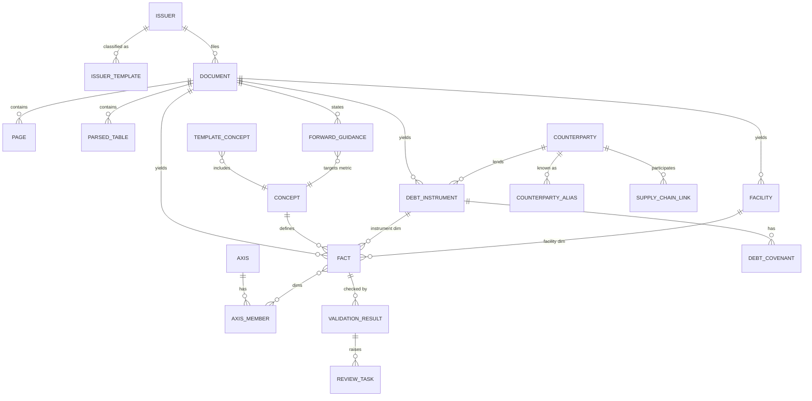

# IDX Emiten Extraction Schema — Design v0.3

**Scope.** Audited and interim financial statements (LK), annual reports, sustainability reports, public expose and investor decks, prospectuses, IDX disclosures.
**Goal.** One schema that holds a USD-reporting coal miner, a nickel HPAL operator, a conventional bank, a sharia bank, a PSAK 117 insurer, a property developer and a retailer, with no DDL change when the next industry arrives.

| File | Role |
|---|---|
| `DESIGN.md` | Rationale, data model, time semantics, validation, pipeline, evaluation |
| `extraction_contracts.py` | Pydantic v2 contracts every extractor must emit (as-reported, provenance-first). Smoke-tested |
| `storage_ddl.sql` | Delta / Spark SQL: reference → bronze → silver → gold views |
| `taxonomy_seed.yaml` | Templates, regimes, 52 axes, 56 units, 148 concepts, 154 KPIs in 28 packs, 30 derived metrics, 33 validation rules |

---

## 1. Six decisions that shape everything

### 1.1 Industry variance lives in dictionaries, not columns
Wide per-industry tables (`bank_balance_sheet`, `coal_operations`) break the moment an insurer arrives or an issuer renames a segment. Every number is a **fact**: `(issuer, concept, period, dimensions, scenario) → value, unit, provenance, assurance`. This is XBRL's data model. A new industry is new rows in `concept`, `template_concept` and the KPI packs. Wide tables exist only as generated gold views for consumption.

### 1.2 Split by output shape, not by source section
The source info map suggests two schemas: tabular (statements) and narrative (MD&A, supply chain). That split follows the document layout, but extractors should follow what they produce. MD&A contains tables (production by mine), and the notes contain prose (covenant clauses, litigation, policy choices). Three shapes:

| Shape | What it is | Examples | Grain |
|---|---|---|---|
| **Facts** | Any number with a period | Statement lines, note tables, rollforwards, sensitivity analyses, KPIs, ESG, headcount | One value |
| **Records** | Real-world objects with many attributes that persist across periods | Loan facilities, bonds, covenants, derivatives, concessions and smelters, subsidiaries, shareholders, officers, litigation, supplier/customer links, audit report | One object per snapshot |
| **Assertions** | Claims made in text | Guidance and capex plans, driver attribution, risk factors, accounting policy choices | One claim with evidence span |

Records join to facts through dimensions. A facility's spread and covenants live on the record; its outstanding balance each year is a fact with `instrument=<id>`. A smelter's nameplate capacity lives on the record; its output and utilization are facts with `facility=<id>`.

### 1.3 Preserve as-reported, map separately
Extraction emits labels as printed (ID and EN on bilingual pages), presented hierarchy, note references and raw cell text. Mapping to `concept_id` is a separate step with its own method and confidence, backed by `label_mapping` so approved mappings are reused instead of re-asking an LLM. When the taxonomy changes you remap, not re-extract, and extraction accuracy and mapping accuracy are measured independently. Lines that truly have no canonical home become `ext.<ticker>.<slug>` extension concepts rather than being forced into "other".

### 1.4 Deterministic numbers, probabilistic structure
LLMs locate, segment and label. Code parses numbers. Contracts require `raw_text` for every value; `parse_reported_number` applies locale (`1.234,5` vs `1,234.5`), parentheses as negatives, dash as nil, and the loader applies document scale (`dalam jutaan Rupiah`, `expressed in thousands of US Dollars`). A value that isn't found verbatim on its cited page fails the `grounding` rule. This one rule removes most hallucinated numbers.

### 1.5 Prefer XBRL for face statements when it exists
The IDX taxonomy groups issuers into 8 entry points by presentation format, has separate current/non-current and liquidity-based balance sheet variants, and uses direct-method operating cash flow (except collective investment contracts). When an XBRL instance is available for a filing, load primary statements from it and spend PDF/LLM effort on notes, MD&A and KPIs. `concept.xbrl_element` makes both paths land on the same concept ids. Coverage and tagging quality vary by issuer-year, so treat XBRL as a high-trust source, still subject to validation.

### 1.6 Every row carries provenance, assurance and knowledge time
Provenance: document, page, bbox, table/cell coordinates, extractor version, model, prompt version, run id, confidence. Assurance comes from where the number appeared, not what it is: segment revenue in the notes is `audited`; the same figure in a public expose deck is `unaudited`. Knowledge time is the document's publication timestamp, separate from the period the value describes (§3).

---

## 2. Model overview

Medallion mapping: **bronze** holds documents, pages, parsed tables and text chunks (immutable, re-extractable). **Silver** holds facts, records, assertions, validation results and the review queue. **Gold** holds `fact_latest`, `fact_first_reported`, point-in-time queries, discrete quarters, standardized statement views per template, derived metrics, KPI panels and guidance-vs-actual.

### 2.1 The fact tuple
| Part | Columns | Notes |
|---|---|---|
| What | `concept_id`, `label_raw`, `label_raw_alt`, `note_ref`, `mapping` | `concept_id` nullable until mapped |
| When | `period_type`, `period_start`, `period_end`, `fiscal_period`, `duration_months`, `is_cumulative_ytd` | Instants have no start |
| Context | `scenario`, `dims`, `dim_key`, `basis`, `consolidation_scope` | `dim_key` is a sorted string because Spark cannot group or join on a MAP |
| Value | `value`, `value_text`, `raw_text`, `unit_id`, `currency`, `scale_as_reported` | `value = parsed × scale`, in the concept's natural balance sign |
| Trust | `assurance`, `is_restated_column`, `is_comparative`, `review_status`, `knowledge_ts`, `lineage` | |

Sign convention follows XBRL: values are positive in the concept's natural direction (cost of revenue is stored positive with `balance=debit`), and arithmetic signs live in formulas and validation rules. `raw_text` keeps the printed sign for audit.

### 2.2 Dimensions do the heavy lifting
The same fact table represents very different disclosures once axes are standardized (full list in `taxonomy_seed.yaml`):

| Disclosure | Concept | Axes |
|---|---|---|
| Statement of changes in equity | movement concepts | `equity_component` (columns) |
| PP&E note | `note.ppe.gross_carrying` | `asset_class` × `movement` |
| Borrowings note | `note.borrowings.outstanding` | `instrument`, `counterparty`, `currency_denomination`, `maturity_bucket` |
| Segment note | `note.segment.revenue` | `segment_business` (issuer-defined, mapped to standard), `segment_geography` |
| Bank loans | `fs.bs.bank.loans_gross` | `loan_segment`, `ecl_stage`, `currency_denomination` |
| FX sensitivity | `note.fin_risk.sensitivity_profit` | `risk_variable`, `sensitivity_shift` |
| Nickel output | `op.nickel.product_output` | `product`, `facility`, `metal_basis`, `basis` |
| Coal reserves | `op.coal.reserves` | `reserve_class`, `reporting_code`, `basis` |

Issuer-defined members (segments, products, cost components) are stored per issuer in `axis_member` with a `std_member_id` so "Segmen Nikel" and "Nickel Business Unit" both roll up to `nickel` for cross-issuer panels.

---

## 3. Time semantics

**Instant vs duration.** Balance sheet items, reserves, store counts and headcount are instants. Income statement, cash flow, production and emissions are durations.

**Cumulative interim periods.** IDX interim income statements and cash flows are year-to-date (Q1 = 3M, H1 = 6M, 9M). Facts store `duration_months` and `is_cumulative_ytd`; `gold.fact_discrete_quarter` derives quarters by subtraction and refuses to label H1 as Q2 when Q1 is missing. Derived Q4 (FY − 9M) absorbs year-end audit adjustments and is flagged as such.

**Comparatives and restatements.** Each filing contains prior-period columns, sometimes marked "disajikan kembali" and sometimes with a third balance sheet column at the start of the comparative year. Every occurrence is stored; nothing is overwritten. The same `(concept, period, dim_key)` therefore appears once per filing that disclosed it.

**Bitemporal views.** Valid time is the reporting period; knowledge time is `document.published_at`.

| View | Selection | Use |
|---|---|---|
| `fact_latest` | Highest assurance, then most recent knowledge time | Fundamental analysis on best-known numbers |
| `fact_first_reported` | Earliest knowledge time | Earnings surprise, guidance-vs-actual, restatement analysis |
| Point-in-time query | Latest with `knowledge_ts <= :as_of` | Backtests. Using restated numbers in a backtest is look-ahead bias |

**Guidance** carries `stated_at` so you can measure how often a management team hits its own production and capex targets, which is a useful credibility signal in its own right.

---

## 4. Templates and accounting regimes

Templates are assigned per issuer with validity dates (`issuer_template` is SCD2, because holding restructurings and business pivots happen), plus an `is_sharia` overlay that adds temporary syirkah funds to the balance sheet identity and enables the `sharia_contract` axis.

Accounting regime is recorded per document, because standards change what the numbers mean:

| Regime | From | Series break? | What changes |
|---|---|---|---|
| `PRE_2020` | — | — | Operating leases off balance sheet, incurred-loss impairment |
| `PSAK71_72_73` | 2020-01-01 | Yes | ROU assets and lease liabilities appear, rent moves below EBITDA, ECL provisioning |
| `PSAK_RENUMBERED` | 2024-01-01 | No | IFRS-aligned numbering (71→109, 72→115, 73→116, 5→108). Reference mapping only; `concept.standard_refs` stores both |
| `PSAK117` | 2025-01-01 | Yes (insurers) | Insurance revenue, service result, CSM. Premium income leaves the face statement, so `INSURANCE_P117` is a separate template and GWP becomes an MD&A KPI |

Face-statement items the general info map misses, all included in the seed:

| Industry | Items |
|---|---|
| Mining | Exploration and evaluation assets, mine properties, deferred stripping, rehabilitation and closure provision, royalties inside cost of revenue |
| Plantation | Bearer plants (mature/immature), biological assets, plasma receivables |
| Property | Real estate inventories (land, under development, completed), large customer advances, often unclassified balance sheet |
| Bank | Placements, marketable securities by measurement category, loans by segment and ECL stage, deposits by CASA/time, impairment expense |
| Sharia | Temporary syirkah funds between liabilities and equity, financing by contract type |
| Insurance | Insurance/reinsurance contract balances (PSAK 117) or technical reserves (legacy) |
| Financing | Consumer financing receivables, finance lease receivables |

---

## 5. Records

| Table | Key attributes | Linked facts |
|---|---|---|
| `license_agreement` | Type (brand license, franchise, exclusive distribution, in-licensed product, toll manufacturing), direction, counterparty, brands, territory, exclusivity, expiry, royalty basis | Royalty expense by counterparty; renewal calendar |
| `debt_instrument` + `debt_covenant` | Type, borrower entity, lenders/trustee, currency, limit, fixed/floating, benchmark + spread, coupon, maturity, collateral, guarantor, rating; covenant metric, operator, threshold, stated compliance | Outstanding by period; computed covenant headroom |
| `derivative_contract` | Hedged risk, instrument, underlying, notional, maturity, hedge designation | Fair value by period |
| `commitment_contingency` | Kind (capex, take-or-pay, guarantee, litigation, tax dispute…), counterparty, amount, likelihood, provision recognized, `first_seen_doc` | — |
| `facility` | Type (IUP/IUPK concession, smelter, HPAL, mill, store…), status, location, license and expiry, area, products, nameplate capacity, COD | Output, utilization, capacity over time |
| `group_structure` | Parent/child entity, relation, domicile, activity, effective ownership | Subsidiary total assets |
| `shareholder_position` | Holder, type, class, shares, % | — |
| `officer_position` | Person, role, dates, independence, concurrent positions | Remuneration facts |
| `supply_chain_link` | Counterparty, relation, item, share %, basis, whether from the audited major-counterparty note | Revenue/purchases by counterparty |
| `subsequent_event` | Date, category, amount | — |
| `audit_report` | Firm, partner, opinion, emphasis of matter, going-concern uncertainty, key audit matters | — |

**Counterparty resolution** is what turns this into a graph across the exchange. "PT Bank Mandiri (Persero) Tbk", "Bank Mandiri" and "Mandiri" must resolve to one `counterparty_id`. Approach: deterministic normalization (strip PT, Tbk, (Persero), punctuation, casing), then embedding match against `counterparty_alias`, with human confirmation above a materiality threshold. When a counterparty is itself listed, `is_listed_ticker` links it back to `issuer` so lender exposure and supplier dependence can be traversed.

**Instrument identity across years** uses `hash(issuer, borrower, normalized name, signing or issue date)`, so amendments update attributes on a new snapshot row rather than creating a new instrument.

---

## 6. Assertions

**Forward guidance** stores metric, point or range, unit, target fiscal year, dimensions, conditions and funding source. Gold joins it to `fact_first_reported` for guidance-vs-actual.

**Driver attribution** turns "pendapatan naik karena kenaikan harga jual rata-rata" into `metric=revenue, direction=up, driver=price`, with an enum covering volume, price, mix, FX, input cost, royalty/tax, one-off, accounting change, M&A, regulatory, weather and financing. Across years this shows which drivers management leans on.

**Risk factors** carry a category, a normalized title and an embedding, plus `first_seen_fiscal_year`. Year-over-year diffing of new or removed risks is often more informative than the risk text itself.

**Accounting policy choices** (land at cost vs revaluation, inventory costing, useful lives, functional currency, stripping and exploration cost treatment) are coded because they decide whether two issuers' ROE and gearing are comparable at all.

---

## 7. Operational KPI packs

KPIs are concepts with `domain=op|reg|esg|hr`, grouped into packs. Three rules matter more than the list itself.

**An industry-agnostic core comes first.** `op.core.*` covers what any producer, distributor or service business reports: production and sales volume, installed capacity, utilization, ASP, unit cash cost, volume and price growth, market share, facility count, distribution reach, imported input share, TKDN local content, new contracts, order backlog, fleet count. A factory making tiles, textiles or drugs is covered on day one through `product` and `raw_material` dimensions. An industry pack defines its own concept only when qualifiers or definitions genuinely differ (nickel ore in wet tonnes, coal by calorific-value basis), and `concept_broader` links it back to the core so "production volume across all issuers" still works.

**Packs attach to segments, not issuers.** `issuer_kpi_pack` assigns packs per segment member with validity dates. A conglomerate can run automotive, contract mining, coal and plantation packs at once, and the extractor's concept candidates for a page come from the packs assigned to the segment that page discusses.

**Qualifiers are mandatory where they change meaning.** `required_qualifiers` flags a fact that lacks them:

| Qualifier | Why |
|---|---|
| `basis` (100% vs attributable) | JV and partially owned mines report both; mixing them breaks per-share metrics |
| `moisture_basis` (wet vs dry) | Nickel ore tonnage and grade are meaningless without it; `wmt` has its own unit dimension so it can't be silently converted |
| `metal_basis` (contained vs payable) | Concentrate economics depend on payable metal |
| `cv_basis` (GAR, NAR, ADB) | Coal calorific value and pricing benchmarks differ by basis |
| `reserve_class` + `reporting_code` + as-of date | JORC/KCMI proved/probable vs measured/indicated/inferred are not additive |

**Company-defined metrics stay separate.** EBITDA, core profit, cash cost, AISC, SSSG and loan-at-risk are stored as reported with `definition_text` and `is_company_defined=true`, and never merged with computed equivalents. Regulator-defined bank ratios (`reg.bank.*`) are also kept as published: OJK's ROA uses pre-tax profit over average assets, so it will not match a computed net-profit ROA.

---

## 8. Validation

Rules are data (`validation_rule`), evaluated per document after normalization. Tolerance for rounding is `n_terms × scale_as_reported`.

| Group | Hard rules | Soft rules |
|---|---|---|
| Balance sheet | Assets = liabilities (+ syirkah funds) + equity; current + non-current = total; equity = owners + NCI | — |
| Income statement | Gross profit; PBT − tax = profit; attribution sums; TCI = profit + OCI | EPS ≈ attributable profit / weighted shares (2%) |
| Cash flow | CFO + CFI + CFF = net change; opening + change + FX = closing | Closing CF cash = BS cash (fails legitimately with netted overdrafts) |
| Notes | Rollforward opening + movements = closing; PP&E note ties to BS; segments incl. elimination = consolidated revenue | — |
| Cross-filing | — | Comparative equals prior filing unless restated column |
| Integrity | Grounding; unit dimension matches concept | Required qualifiers present; utilization within bounds; volume × ASP ≈ segment revenue |

**Repair loop.** A failed hard rule yields implicated fact ids. Those cells are re-extracted with a targeted prompt that includes the failing equation and the page crop. If the rule still fails, a `review_task` is created with priority `materiality × (1 − confidence)`, so human time goes to large numbers that are probably wrong.

---

## 9. Extraction pipeline and routing

| Stage | Work | Output |
|---|---|---|
| 1. Ingest | Fetch, sha256, doc-type classification, publication timestamp, language and number locale detection | `bronze.document` |
| 2. Parse | Text layer first; OCR only for pages without one; layout and table structure recognition; stitch tables across pages; split bilingual side-by-side columns | `bronze.page`, `bronze.parsed_table`, `bronze.text_chunk` |
| 3. Sectionize | LK: auditor report, five statements, notes by note number and topic. AR: OJK-prescribed chapter structure plus heading classifier | `page.section_type` |
| 4. Extract | Route by `(section_type, template)` via `ROUTES` in `extraction_contracts.py`. XBRL → statements when available. Tables → deterministic parser plus LLM for header/period/hierarchy. Notes and narrative → LLM structured output against the Pydantic contract, with concept candidates retrieved from the dictionary (top-k by label embedding within the template) injected into the prompt | Contract JSON |
| 5. Normalize | Parse numbers, apply scale and sign, resolve periods, build `dim_key`, resolve units and counterparties, explode record balances into facts | Silver rows |
| 6. Map | `label_mapping` exact → fuzzy → embedding → LLM; approvals written back | `fact.concept_id`, `mapping` |
| 7. Validate | Rules, grounding, repair loop, review queue | `validation_result`, `review_task` |
| 8. Publish | Gold views, metrics, KPI panels, guidance-vs-actual | Gold |

Constraining `concept_candidates` to ids injected in the prompt matters: an open-vocabulary LLM will invent plausible concept ids.

---

## 10. Gold layer and derived metrics

Metrics are versioned formulas over concept ids (`metric_definition`), with template applicability, so gearing is never computed for a bank and NIM is never computed for a retailer. A few definitions need care on IDX data:

| Metric | Point |
|---|---|
| D&A and computed EBITDA | Direct-method cash flows don't show D&A. Build it from PP&E, ROU, intangible and mine property rollforwards |
| Working-capital change | Not presented under the direct method. Derive from balance sheet deltas |
| Capex | Keep both `capex_cash` (cash flow) and `capex_rollforward` (note additions). Cash capex understates when additions are financed through payables or leases |
| Net debt | Keep variants with and without lease liabilities; post-2020 comparisons need the choice to be explicit |
| Payout ratio | Final dividends paid in year t come from FY t−1 profit through the RUPS, so use lagged profit |
| Currency | USD presenters stay in USD in silver. Translate in gold only: period-end rate for instants, period-average for durations |

---

## 11. Evaluation

**Golden set.** Stratify by template × presentation currency × number locale × era (pre-2020, 2020–2023, 2024+, insurers 2025+) × scanned vs text-layer. Around 30 filings hand-verified at cell level is enough to start; grow it from review-queue resolutions.

**Metrics.**

| Target | Metric |
|---|---|
| Face and note cells | Exact match after normalization, reported per statement and per note topic |
| Concept mapping | Top-1 accuracy on as-reported labels, by template |
| Records | Entity-level F1 plus attribute accuracy (maturity, spread, threshold) |
| Assertions | Precision on a sampled set; recall on guidance only (it's the one that matters most) |
| System | Hard-rule pass rate; grounding pass rate; review tasks per filing; cost and latency per filing |

**External oracle.** A third-party fundamentals dataset is useful for reconciling statement totals across many issuers cheaply. Treat disagreements as triage signals, not ground truth, since aggregators apply their own mappings and restatement policies.

---

## 12. Build order

| Phase | Scope | Exit criterion |
|---|---|---|
| 1 | Document registry, GENERAL-template face statements, number parsing, grounding, statement validation rules; 4–6 issuers mixing USD and IDR presenters | ≥99% hard-rule pass on the golden set |
| 2 | Notes: borrowings (+ debt instrument records), PP&E rollforward, segments, major customers/suppliers, audit report | Rollforward and segment ties pass |
| 3 | Mining KPI packs with qualifiers, facility records, reserves | Volume × ASP cross-check within tolerance |
| 4 | Assertions: guidance, driver attribution, risk diffing; guidance-vs-actual gold view | Guidance recall measured |
| 5 | BANK template (and sharia overlay) with regulatory ratios | Separate golden set passes |
| 6 | PROPERTY, INFRASTRUCTURE, INSURANCE_P117, FINANCING; counterparty graph | — |

---

## 13. Corrections and additions to the source info map

| Info map says | Adjust to | Why |
|---|---|---|
| Two schemas: tabular vs narrative | Three output shapes: facts, records, assertions | Tables appear in MD&A and prose appears in notes; extractors should be organized by what they emit |
| CFO includes "perubahan modal kerja" | Derive working-capital change from balance sheet deltas | IDX filers use the direct method, which doesn't present those lines |
| Capex = CFI fixed-asset purchases | Store cash capex and rollforward additions | Cash figure misses payables- and lease-financed additions |
| EBITDA as an optional company metric | Compute it from rollforward D&A and store the company figure separately with its definition | D&A isn't on a direct-method cash flow; company definitions vary |
| Customer/supplier concentration is mostly narrative | Partly audited | PSAK 108 (ex-PSAK 5) requires disclosing revenue from customers above 10% of revenue, and many issuers list major customers and suppliers in the notes |
| Segment assets always available | Optional | Only disclosed when reported to the chief operating decision maker |
| General-industry line items | Template-specific concepts | Mining, plantation, property, bank, sharia and insurance statements have their own face items (§4) |
| PSAK 5 / 71 / 73 references | Store old and new numbering | 2024 renumbering; a multi-year backfill sees both |
| Production volume, capacity, ASP | Same, with mandatory qualifiers | Basis, moisture, metal and calorific-value basis change meaning (§7) |
| Not listed | Audit opinion, going-concern uncertainty, key audit matters, accounting policy choices, guidance track record | High signal for investors and cheap to extract |

---

## 14. Industry coverage (v0.2)

Coverage has three layers. **Structural** coverage (fact/record/assertion tables, contracts, time semantics, validation) is industry-agnostic and complete for every IDX-IC sector. **Face-statement** coverage depends on the template. **Operational** coverage depends on KPI packs and is where industries differ.

| IDX-IC sector | Examples of business models | Template | Industry-specific accounting captured | KPI packs |
|---|---|---|---|---|
| Energy | Coal, oil and gas, contract mining, geothermal | GENERAL | E&E assets, mine properties, deferred stripping, rehabilitation provision | `coal`, `oil_gas`, `construction_contractors`, `toll_power`, `core` |
| Basic Materials | Nickel, copper-gold, tin, cement, steel, chemicals, pulp and paper | GENERAL | Mining items above; steel/chemicals/paper need nothing beyond general | `nickel`, `copper_gold`, `tin`, `cement`, `core` |
| Industrials | Automotive, heavy equipment, capital goods, electrical equipment | GENERAL | Contract assets, retention receivables | `automotive_equipment`, `core` (backlog, new contracts) |
| Consumer Non-Cyclicals | FMCG, F&B, tobacco, plantation, poultry and feed, retail staples | GENERAL | Gross-to-net (excise, rebates), excise payable, excise stamps inventory, biological assets, bearer plants | `consumer_goods`, `plantation`, `poultry_feed`, `retail`, `core` |
| Consumer Cyclicals | Specialty and department-store retail, apparel, hotels, media, auto parts | GENERAL | Consignment and principal-vs-agent policy, royalty expense, brand license records | `retail`, `hospitality`, `media`, `core` |
| Healthcare | Pharma manufacturers, hospitals, labs, medical devices, pharmacy retail | GENERAL | R&D expensed vs capitalized, receivables by payer (BPJS/JKN) and customer type, in-licensed products | `pharma`, `healthcare_services`, `retail` (pharmacies), `core` (TKDN, imported API share) |
| Financials | Banks, sharia banks, multifinance, insurers, securities | BANK, FINANCING, INSURANCE(_P117), SECURITIES | ECL stages, syirkah funds, PSAK 117 | `bank`, `multifinance`, `insurance` |
| Properties & Real Estate | Developers, recurring-income property, construction SOEs | PROPERTY | Real estate inventories, contract assets, over-time revenue | `property`, `construction_contractors`, `core` |
| Technology | Platforms and marketplaces, IT services and distribution, data centers | GENERAL (digital banks use BANK) | Principal vs agent, customer incentives as contra-revenue, capitalized software, share-based payment, goodwill impairment | `technology_platform`, `data_center`, `core` (recurring revenue, backlog) |
| Infrastructures | Telco, towers, toll roads, utilities, power | INFRASTRUCTURE | Service concession intangibles | `telco_tower`, `toll_power`, `core` |
| Transportation & Logistics | Shipping, aviation, ports, logistics | GENERAL / INFRASTRUCTURE | ROU-heavy fleets (lease concepts) | `transport_logistics`, `core` (fleet) |

### Known gaps, deliberately left for later
| Gap | Workaround today | Add when |
|---|---|---|
| Steel, chemicals, textiles, pulp and paper specific metrics (spreads, conversion margins) | `op.core.*` with `product` and `raw_material` dims | An issuer in that subsector enters coverage |
| Pharma clinical pipeline stages | `op.pharma.pipeline_products` count only; IDX pharma is mostly generics and branded generics with limited disclosed pipelines | If covering biotech-style disclosures |
| Securities and investment managers (AUM, brokerage value traded) | SECURITIES template face statements only | When a securities issuer is added |
| Sector ESG specifics (e.g. SASB-style metrics) | Generic `esg.*` concepts | When ESG scoring becomes a use case |
| Education, agriculture beyond palm/poultry, gaming | `core` + issuer extension concepts `ext.<ticker>.*` | Promote an extension to a pack once 3+ issuers report it |

The promotion rule in the last row is the general mechanism: issuer extensions accumulate in silver, and when the same unmapped label shows up across several issuers it becomes a candidate for a standard concept. Coverage grows from data, not from guessing lists upfront.

---

## 15. Quarterly and annual reports

Quarterly and annual filings land in the **same tables with the same concepts**. What differs is captured by `document.doc_type`, `fact.fiscal_period`, `duration_months`, `is_cumulative_ytd` and per-column `assurance`. There is no separate "quarterly schema".

### 15.1 What each filing contains
| Filing | Balance sheet columns (instants) | Income statement / cash flow columns (durations) | Notes | Assurance |
|---|---|---|---|---|
| Q1 LK | 31 Mar t vs 31 Dec t−1 | 3M t vs 3M t−1 | Condensed | Current column unaudited; year-end column audited |
| H1 LK | 30 Jun t vs 31 Dec t−1 | 6M t vs 6M t−1 | Condensed | Unaudited, limited review or audited (issuer-dependent) |
| 9M LK | 30 Sep t vs 31 Dec t−1 | 9M t vs 9M t−1 | Condensed | Current column unaudited |
| FY LK | 31 Dec t vs 31 Dec t−1 (+ 1 Jan t−1 if restated) | FY t vs FY t−1 | Full | Audited |
| Annual report | Reprints the audited LK at the back | Same | MD&A, KPIs, guidance, governance | Embedded LK section = audited; narrative = management |
| Production update / investor deck | — | Often **discrete** quarters (Q3 alone), not YTD | — | Unaudited |

There is no standalone Q4 filing. Q4 exists only as FY − 9M.

Two consequences for extraction. First, **assurance is per column, not per document**: `PeriodRef.assurance` carries the column's "Diaudit / Tidak diaudit" label, so the 31 Dec t−1 column of a 9M filing is stored as audited. Second, **condensed interim notes are not extraction failures**: `template_concept.expected_in` limits annual-only expectations (full rollforwards, aging, sensitivity analyses, major customers) to `fs_annual`.

### 15.2 Every number arrives several times
The 31 Dec 2024 cash balance appears in the FY2024 LK, again as the comparative column in the Q1, H1 and 9M 2025 LKs, and again in the FY2025 LK. 9M2024 revenue appears in the 9M2024 LK and again in the 9M2025 LK. All occurrences are stored with their own `doc_id` and `knowledge_ts`. `fact_latest` picks one; `interim_year_end_column_ties_annual` and `ytd_comparative_ties_prior_interim` flag drift, which is either an extraction error or an unlabeled restatement. Both are worth knowing.

### 15.3 Derived periods (tested on Spark)
**Discrete quarters** (`gold.fact_discrete_quarter`) come from two sources. Cumulative filings give Q1 = 3M, Q2 = H1 − Q1, Q3 = 9M − H1, Q4 = FY − 9M. Discrete disclosures (quarterly production releases, decks) are taken as reported. When both exist, statement and note concepts prefer the YTD derivation, since it ties to filed numbers, and operational KPIs prefer the reported quarter; `has_alternate_source` marks the overlap for the `derived_vs_reported_quarter` check. The view:
- subtracts only concepts with `period_aggregation = additive`, so EPS, margins, prices, utilization and weighted-average shares are never differenced;
- refuses to emit Q2 from H1 when Q1 is missing;
- flags derived Q4 with `absorbs_year_end_adjustments`, because year-end impairments, audit adjustments and bonus true-ups all land there.

**TTM** (`gold.fact_ttm`) sums four discrete quarters and is emitted only when they are consecutive. It equals FY t−1 + YTD t − YTD t−1, and it carries `includes_year_end_adjusted_quarter`.

Test case, cumulative revenue filed as Q1 100, H1 210, 9M 330, FY 480, then Q1'25 120, H1'25 250, 9M'25 390:

| Output | Result |
|---|---|
| Discrete 2024 | Q1 100, Q2 110, Q3 120, Q4 150 (flagged) |
| Discrete 2025 | Q1 120, Q2 130, Q3 140 |
| TTM | Dec'24 480, Mar'25 500, Jun'25 520, Sep'25 540 |
| Issuer missing its Q1 filing | No Q2 emitted, Q3 still derived, no TTM |
| EPS | Excluded |
| Coal production: reported Q4 6.4 vs FY − 9M 6.5 | Reported quarter used, alternate source flagged |

### 15.4 Point-in-time with a quarterly cadence
`knowledge_ts` is the actual publication timestamp, so an April 2025 backtest date sees FY2024 (published around end of March) as the latest period and TTM = FY2024. A November 2025 date sees 9M2025, so TTM = FY2024 + 9M2025 − 9M2024. Use real publication timestamps rather than regulatory deadlines; late filers and extensions are common enough to matter.

### 15.5 Ratio conventions across cadences
Average balances for quarterly ratios use quarter-end instants (the interim balance sheets), not just year-end pairs. Days-based metrics (DSO, DIO, DPO) use `days` of the actual period, so a 9M figure isn't compared with an annual one unannualized. Seasonal businesses (retail around Lebaran, plantation output cycles) should be compared on TTM or same-quarter-last-year, never quarter-on-quarter by default.
